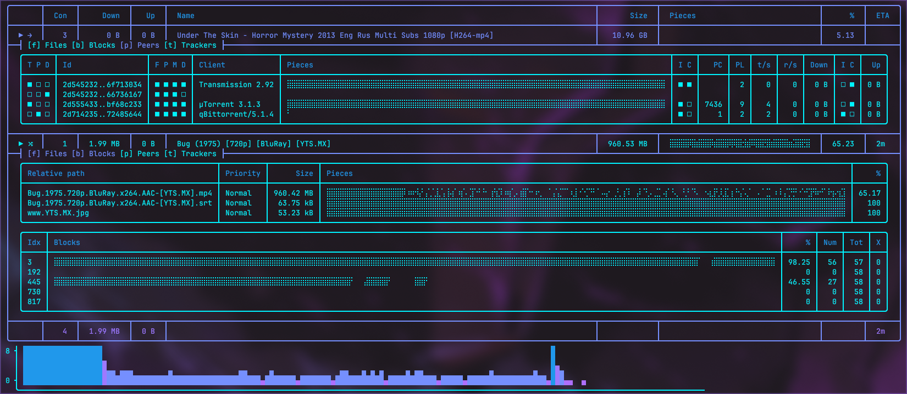

**Victoria** is a BitTorrent client written in Rust with the intention
of deeply exploring the BitTorrent protocol for my own satisfaction
and curiosity.

The project includes a custom implementation of the BitTorrent peer
protocol and Mainline DHT, with an asynchronous architecture powered
by Tokio. A TUI framework called whodatrow was also custom-built for
easy visualisation of all the client state. It makes deugging easy
while being pleasant on the eyes.

# Features
## BitTorrent
| Feature | Status | Receive | Send | Notes |
|---|---|---|---|---|
| Bencode parser | Implemented | | | |
| Torrent file parsing | Implemented | | | Lacks nodes and HTTP seeds |
| Magnet link support | Implemented | | | Lacks nodes |
| UDP trackers | Implemented | ✅ | | |
| HTTP trackers | Implemented | ✅ | | |
| Peer wire protocol | Implemented | ✅ | ✅ | |
| Metadata exchange | Implemented | ✅ | ✅ | |
| PEX | Implemented | ✅ | | |
| uTP | Unimplemented | | | |
| Piece transfer | Implemented | ✅ | ✅ | Lacks end-game and opportunistic unchoking|
| Piece verification | Implemented | | | |
| Sequential downloading | Implemented | | | |
| File priorities | Implemented | | | |

## DHT
| Feature | Status |
|---|---|
| Bootstrapping | Implemented |
| Peer discovery | Implemented |
| Maintenance | Unimplemented |
| Contributing | Unimplemented |

# Usage
Launch the TUI:
```bash
victoria
```
Torrents will be under victoria in your download folder.

# Building
Clone the repository:
```bash
git clone <repository-url>
cd victoria
```
Build the project:
```bash
cargo build --release
```

# License
Victoria is licensed under the MIT License.
